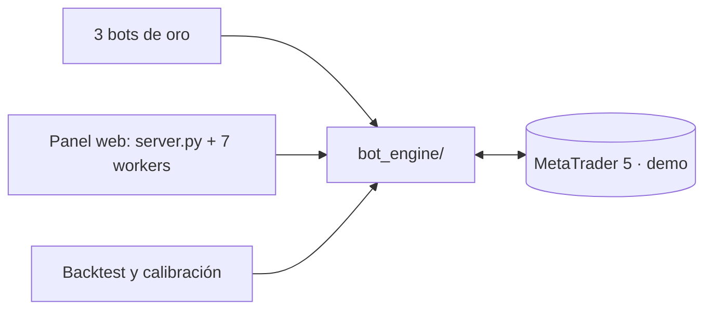

# Bots de Trading MetaTrader 5 · Aurum

Bots de trading automático para **MetaTrader 5**, enfocados **solo en el oro (XAU/USD)**, igual que el panel
web. Todo comparte **un solo motor** (`bot_engine/`). Se suman un panel
web local para operar con un clic y un backtester que reproduce el motor real sobre 3 años de histórico.

- **Tres bots automáticos de oro**: swing, scalping y **scalping + grid + cesta** (varias operaciones
  cortas a la vez, órdenes límite pendientes, cierre de la cesta por profit total y lote que crece con
  el capital). Cada uno tiene su `config.py`.
- **Panel web Aurum.** Tarjetas por activo con dirección en tiempo real y apertura de órdenes demo con
  un clic. Incluye noticias financieras, calendario económico y horarios de mercado en la hora del sistema.
- **Tres modelos, un solo activo.** Swing (H1), scalping (M15) y grid + cesta (H1). El panel usa la misma
  configuración que cada bot (`dashboard/profiles/xauusd_<modo>/`).
- **Filtro predictivo.** Gradient boosting, validado fuera de muestra y activo solo donde logra ≥ 75 % de
  acierto con ganancia.
- **Riesgo que se adapta al capital.** Opera desde 50 USD con un riesgo elevado acotado por bot (medido en
  `reports/small_account.md`), un corte diario, un corte total por drawdown y un límite diario de cuenta.

> **Solo Windows y solo demo.** La API de Python de MT5 necesita el terminal abierto en la misma PC.
> Los bots y el panel se niegan a operar una cuenta real salvo `ALLOW_LIVE_TRADING=1` en el `.env`.

## Tecnología

| Pieza | Versión / detalle |
|---|---|
| Python | 3.9+ (probado con 3.13) |
| MetaTrader5 (paquete) | ≥ 5.0.37, con el terminal MT5 abierto |
| pandas / numpy | Indicadores y backtest |
| scikit-learn | ≥ 1.5, solo para el filtro predictivo (import diferido) |
| python-dotenv | Credenciales desde `.env` |
| Panel | Librería estándar (`http.server`), HTML/CSS/JS propios, sin frameworks |

## Arquitectura



El detalle está en [docs/ARCHITECTURE.md](docs/ARCHITECTURE.md), y el porqué de cada decisión en
[docs/adr/](docs/adr/).

## Empezar

1. **Instala** las dependencias (son las mismas para todo el repo):
   ```bash
   pip install -r requirements.txt
   ```
2. **Credenciales.** Copia la plantilla: `cp .env.example .env`. El `.env` está en `.gitignore`.
   ```env
   MT5_LOGIN=0            # 0 = usa la cuenta ya abierta en el terminal MT5
   MT5_PASSWORD=
   MT5_SERVER=
   TELEGRAM_BOT_TOKEN=    # opcional
   TELEGRAM_CHAT_ID=      # opcional
   ```
3. **Abre MetaTrader 5** con una cuenta **demo** y activa **Algo Trading**.
4. **Lanza** lo que necesites:
   ```bash
   python run.py                  # menú interactivo
   python run.py oro              # oro swing H1/H4/D1   (también: oro_scalping | oro_grid)
   python run.py dashboard        # panel web → http://127.0.0.1:8765
   ```
   Se detiene con **Ctrl+C**. Las posiciones abiertas quedan en MT5. Cualquier cambio de config
   necesita reiniciar el proceso.

> **Histórico M5.** Para hacer backtest en M5 con 3 años, en MT5 ve a *Herramientas → Opciones →
> Gráficos → Máx. barras en el gráfico* y pon **Ilimitado**. Reinicia el terminal. Sin ese ajuste,
> M5 solo trae unos 17 meses.

## Estructura

```
Bot-XAU-USD/
├── run.py                 lanzador (bots y panel)
├── bot_engine/            EL MOTOR COMPARTIDO: señales, riesgo, órdenes, filtro predictivo
├── xauusd_bot/            config.py + main.py  · oro swing        (magic 20260618)
├── xauusd_scalping_bot/   config.py + main.py  · oro scalping     (magic 20260621)
├── xauusd_grid_bot/       config.py + main.py  · oro scalping + grid + cesta (magic 20260622)
├── dashboard/             panel: server.py, worker.py, static/index.html
│   └── profiles/          _base.py y 3 perfiles xauusd_<modo>/config.py (swing, scalping, grid)
│                          (magic 20260630; la pestaña Grid usa 20260631)
├── backtesting/           engine_backtest.py, calibrate.py, xau_suite.py, README.md
├── models/                modelos .joblib + manifest.json (generados, fuera de git)
├── tests/                 test_engine.py
└── docs/                  ARCHITECTURE, PRD, DESIGN_SYSTEM, adr/, guías por instrumento
```

## Funcionalidades clave

### Los 3 bots (solo XAUUSD)

| Carpeta | Estilo | Temporalidades | Loop |
|---|---|---|---|
| `xauusd_bot/` | Swing (≈ 1 operación al día) | H1 / H4 / D1 | 30 s |
| `xauusd_scalping_bot/` | Scalping | M15 / H1 / H4 | 15 s |
| `xauusd_grid_bot/` | Grid + cesta | H1 / H4 / D1 | 5 s |

Cada bot solo gestiona sus propias posiciones (filtra por su número mágico), así que pueden correr a la
vez en la misma cuenta. El nombre del oro cambia según el broker (`XAUUSD`, `GOLD`, `XAUUSDm`); se
ajusta en `SYMBOL`. La guía detallada está en [docs/GUIA_GOLD.md](docs/GUIA_GOLD.md).

### Scalping + grid + cesta (`xauusd_grid_bot/`, `bot_engine/grid.py`)

- **Entrada.** Usa la misma señal del swing H1 (umbral 4.0). Con BUY/SELL abre una **cesta**: el nivel 0 a mercado y
  `GRID_LEVELS − 1` órdenes **límite pendientes** en contra, cada `GRID_SPACING_ATR × ATR`. Las pendientes
  solo se activan si el precio llega.
- **Salidas cortas.** Cada operación tiene un TP corto propio (`GRID_TRADE_TP_ATR`). Al cerrarse, su nivel
  se vuelve a armar mientras la cesta siga viva.
- **Stop real.** Todas las órdenes comparten un SL en el bróker, `GRID_STOP_BEYOND_ATR × ATR` más allá
  del último nivel. Protege aunque el bot se caiga.
- **Tamaño por riesgo (para no quemar la cuenta).** El lote se calcula para que la cesta **completa**
  (todos los niveles llenos y el stop tocado) pierda como máximo `GRID_RISK_PCT` del capital. Con poco
  capital usa menos niveles; al crecer la cuenta vuelven los niveles y sube el lote (lote dinámico). Si ni
  1 nivel con el lote mínimo cabe en `GRID_MAX_RISK_MIN_LOT`, no abre y dice cuánto capital falta. En
  martingala (`GRID_LOT_MULT` por nivel) el riesgo total es el mismo.
- **Cesta.** Se cierra completa al ganar `GRID_BASKET_TP_R ×` su riesgo, en el stop o a los
  `GRID_MAX_MINUTES`.
- **Calendario.** Cierra todo el viernes a `GRID_FRIDAY_CLOSE_HOUR` (hora del servidor) y no abre en
  `GRID_BLOCK_HOURS` (corte diario). Ahí estaban las pérdidas por hueco.
- **Corte por drawdown.** Si la equity cae `GRID_MAX_DD_PCT` desde su máximo, cierra todo y deja de abrir
  cestas hasta que se reinicie el bot.
- **Resultados medidos** en `backtesting/reports/xau_suite.md` (`python backtesting/xau_suite.py`).

### Panel web (Aurum)

- **Inicio.** Reloj en la hora del sistema, balance y nivel de la cuenta, y las sesiones de Sídney,
  Tokio, Londres, Nueva York y el mercado del oro, con barra de 24 h y "abre / cierra en…".
  Debajo, los próximos eventos de alto impacto.
- **Mercados.** Solo XAUUSD, en los modos Swing / Scalping / **Grid**. Grid muestra los niveles de la próxima cesta y el estado de la cesta abierta. Cada
  tarjeta muestra el precio, el score, RSI, ADX, la probabilidad del modelo y el lote con su riesgo.
  El botón **destella** fuerte con una señal completa y suave cuando solo hay sesgo. Al confirmar,
  responde: *"Se ha realizado la apertura de una operación BUY/SELL…"*.
- **Noticias.** Titulares de Google Noticias, CNBC e Investing.com, más el calendario económico de
  ForexFactory, todo en hora local.
- **Contenido de ayuda.** Acerca del bot, Velas japonesas, Conceptos clave y Soporte (errores comunes).
- **Aviso de calidad.** Un perfil sin ventaja fuera de muestra muestra **"Sin ventaja probada"**.

### Comportamiento según el capital

| Nivel | Capital | Operaciones abiertas | Corte diario |
|---|---|---|---|
| Micro | < 500 USD | 1 | 5 % |
| Pequeño | 500 – 2 000 USD | 2 | 7 % |
| Estándar | ≥ 2 000 USD | `MAX_OPEN_TRADES` | `MAX_DAILY_LOSS_PCT` |

- **Riesgo normal.** Es el 1 % por operación.
- **Riesgo elevado.** Si el lote mínimo arriesga más del 1 % pero ≤ `MAX_RISK_MIN_LOT`, se opera y se
  avisa "riesgo elevado", junto con el capital necesario para volver al 1 %.
- **Menos de 300 USD (pedido del usuario).** El apalancamiento 1:500 deja abrir 0.01 lote con ≈ 8 USD de
  margen, pero el stop de 0.01 lote cuesta hoy 10–25 USD. Los topes salen de `backtesting/small_account.py`
  (último año, arranques de 90 días): swing 50 % + corte total −30 % (`MAX_DD_PCT`), scalping 15 % + −50 %,
  grid 25 % (con su corte −30 %). Ninguna cuenta se quemó, pero la **mediana pierde** con 50–300 USD
  (swing −49 % / −30 % / −16 % con 50 / 100 / 300). Con riesgo normal (1 %) los tres ganaron en 2026.
- **Cuenta pequeña (`MICRO_SL_FIT`, apagado en los 3 bots).** Si ni así cabe el lote mínimo, se **acercan el
  SL y el TP** (mismo R:R) hasta que quepa, sin bajar de `MICRO_MIN_SL_ATR × ATR` y con el spread ≤ 25 % del
  stop. Medido: empeora el scalping y el swing H1 (el SL queda en el ruido). Sigue encendido en los perfiles
  swing del panel (base H4), donde es lo único que deja operar con 50–100 USD. El panel lo marca como
  "Cuenta pequeña".
- **Sin operar.** Si ni con el SL acercado cabe, el activo no se opera y se dice cuánto capital falta.
- **Límite de cuenta.** Hay además un corte del 10 % diario para toda la cuenta, sumando bots y panel
  (`ACCOUNT_MAX_DAILY_LOSS_PCT`).
- **Spread.** Una operación se descarta si el spread supera el 25 % de su stop.

### Backtest, calibración y filtro predictivo

```bash
python backtesting/xau_suite.py                                                # los 3 bots en M1/M5/M15/H1 (+H4)
python backtesting/engine_backtest.py xauusd_bot H1 --ml                       # un bot
python backtesting/engine_backtest.py xauusd_swing H1 --ml                    # un perfil del panel
python backtesting/calibrate.py xauusd_scalping_bot --tfs M5,M15              # calibración walk-forward
python backtesting/small_account.py                                         # riesgo de cuentas chicas
```

- **Backtest.** Reproduce el motor real vela a vela con 3 balances (100 / 1 000 / 10 000 USD) y Monte
  Carlo. Con `--ml` entrena el filtro predictivo con walk-forward y purga; el modelo solo se guarda si,
  **fuera de muestra**, logra ≥ 75 % de acierto con PF > 1.
- **Calibración.** `calibrate.py` elige el umbral, el SL/TP, la regla de ventas y la
  temporalidad, y solo escribe en el config si mejora fuera de muestra.
- **Más detalle** en [backtesting/README.md](backtesting/README.md).

## Flujo de trabajo

- **El motor se cambia una sola vez,** en `bot_engine/`, y aplica a los bots, al panel y al backtest.
- **Lo que debe ser distinto por bot** se resuelve con una clave de config (leída con `getattr` y
  valor por defecto), nunca copiando código.
- **Después de cambiar el motor o un config**, se vuelve a correr el backtest. El hash cambia, así que
  se recalculan las señales y se reentrenan los modelos.

## Estándares de código

- **Imports.** Entre módulos del motor son relativos (`from .signals import …`); la configuración se
  lee con `from config import …`.
- **Horas de MT5.** Son del **servidor**: se usa `data_handler.server_now()`, nunca `datetime.now()`.
- **Comentarios.** Solo explican el porqué. Los atajos con límite conocido se marcan con
  `shortcut: <límite>, <cuándo mejorarlo>`.
- **Seguridad.** Se siguen las reglas de [SECURITY.md](SECURITY.md) y de [AGENTS.md](AGENTS.md).

## Pruebas

```bash
python tests/test_engine.py                      # asserts simples, sin pytest ni terminal MT5
python -m py_compile bot_engine/*.py */config.py dashboard/*.py backtesting/*.py
```

Cubren:
- **Riesgo:** tamaño de lote, riesgo elevado, límite diario de bot y de cuenta, regla del spread.
- **Gestión de posiciones:** el trailing nunca se ajusta en pérdida.
- **Modelos y validación:** el manifiesto rechaza un modelo alterado; el walk-forward no mira el futuro.
- **Calibración:** aplicar el umbral después equivale a correr el motor con ese umbral.
- **Panel:** el parser de noticias es seguro y se validan las órdenes.

## Contribuir

- **Lee primero** [AGENTS.md](AGENTS.md) (también vale para personas) y
  [docs/ARCHITECTURE.md](docs/ARCHITECTURE.md).
- **Decisiones grandes:** cada una lleva su ADR en `docs/adr/`, con número correlativo.
- **Antes de entregar:** los tests en verde, `py_compile` limpio, y el resultado probado en la demo.

## Referencia del motor

### Ciclo

1. **Conexión.** Verifica MT5 y que la cuenta sea demo.
2. **Datos.** Descarga las velas de 3 temporalidades sin la vela en formación. También calcula el
   order-flow y el sesgo del dólar.
3. **Indicadores y patrones.** EMA 9/21/50/200, RSI, MACD, ATR, ADX, Bollinger, VWAP y S/R, más
   44 patrones de velas (su aporte se limita a ±4).
4. **Señal.** Suma ponderada → score (rango ≈ ±12). Si supera `MIN_SIGNAL_SCORE` es BUY/SELL; si no,
   HOLD.
5. **Filtro predictivo** (si hay modelo): veta la señal si la probabilidad queda bajo τ.
6. **Riesgo.** Nivel de capital, límites diarios, lote dinámico, SL y TP.
7. **Gestión.** En cada ciclo aplica break-even BE+ y trailing progresivo a las posiciones abiertas.

### Pesos del score (oro swing como referencia)

| Componente | Peso | Qué mide |
|---|---|---|
| EMAs | 1.3 | Dirección y momentum |
| RSI | 1.0 | Sobrecompra / sobreventa |
| MACD | 1.1 | Cruce de momentum |
| Patrones de velas | 0.8 | Reversión / continuación |
| Bollinger | 0.7 | Rango y compresión |
| Soporte / Resistencia | 0.9 | Niveles clave |
| VWAP / Volumen | 0.1 / 0.4 | Precio justo y confirmación |
| TF de tendencia | 1.0 | EMAs de la temporalidad superior |
| Macro | 0.8 / 0.5 | Tendencia de la TF mayor |
| Order-flow | 0.5–0.8 | Presión compra / venta por ticks |
| Índice dólar (DXY) | 0.3–0.8 | Sesgo del dólar, inverso |

### Filtros que bloquean entradas

Solo frenan **aperturas nuevas**; nunca cierran una posición abierta.

| Filtro | Flag | Qué hace |
|---|---|---|
| Alineación de tendencia | `REQUIRE_TREND_ALIGNMENT` | Solo opera a favor de la tendencia de la TF primaria. |
| Anti-agotamiento RSI | `RSI_NO_SELL_BELOW` / `RSI_NO_BUY_ABOVE` | No vende en el suelo ni compra en el techo. |
| ADX | `USE_ADX_FILTER` | No opera con mercado lateral (ADX < `ADX_MIN_TREND`). |
| Macro | `REQUIRE_MACRO_ALIGNMENT` / `REQUIRE_MACRO_FOR_SELL` | Veta operar contra la TF mayor; la segunda veta solo las ventas. |
| Noticias | `USE_NEWS_FILTER` | No opera ± minutos alrededor de eventos de alto impacto. |
| Filtro predictivo | `USE_ML_FILTER` | No opera si P(TP antes que SL) < τ. |

### Interruptores

| Flag | Por defecto | Efecto |
|---|---|---|
| `USE_BREAKEVEN` / `USE_TRAILING_STOP` / `USE_PROGRESSIVE_TRAIL` | `True` | BE+, trailing y lock progresivo. |
| `USE_ANTI_DUPLICATE` | `True` | Separación mínima entre entradas en la misma dirección. |
| `USE_ADX_FILTER` / `USE_ORDERFLOW` / `USE_INTERMARKET` | `True` | Factores direccionales. |
| `USE_NEWS_FILTER` / `NEWS_FAIL_OPEN` | `True` / `True` | Filtro de noticias; si no carga el calendario, permite operar. |
| `USE_TELEGRAM` | `True` | Avisos al celular; se desactiva solo si faltan las claves. |
| `USE_ML_FILTER` | según config | Filtro predictivo (necesita un modelo registrado). |
| `MAX_RISK_MIN_LOT` | `0.05` | Riesgo máximo que se acepta con el lote mínimo. |
| `ACCOUNT_MAX_DAILY_LOSS_PCT` | `0.10` | Corte diario de toda la cuenta. |

### Afinado por bot (valores actuales)

| Parámetro | Oro swing | Oro scalp | EUR swing | EUR scalp |
|---|---|---|---|---|
| `MIN_SIGNAL_SCORE` | 5.0 | 5.5 | 5.0 | 4.5 |
| `SL_ATR_MULT` / `TP_ATR_MULT` | 2.0 / 4.5 | 1.5 / 3.0 | 1.2 / 2.7 | 1.0 / 1.5 |
| `MIN_RR` | 2.0 | 1.8 | 2.0 | 1.2 |
| `RISK_PER_TRADE` / `MAX_OPEN_TRADES` | 1 % / 5 | 1 % / 3 | 1 % / 3 | 1 % / 3 |
| `MAX_DAILY_LOSS_PCT` | 10 % | 10 % | 5 % | 5 % |
| Filtro predictivo / ventas solo con macro bajista | sí / sí | no / no | no / no | no / no |

`config.py` siempre manda: esta tabla es una foto y puede quedar desactualizada.

### Telegram (opcional)

Avisa cuando un bot arranca o se detiene, cuando abre o cierra una operación (con su P&L) y cuando se
pierde o recupera la conexión con MT5. Se configura una vez: crea un bot con @BotFather, consigue tu
id con @userinfobot, escríbele "hola" a tu bot y pon `TELEGRAM_BOT_TOKEN` y `TELEGRAM_CHAT_ID` en el
`.env`. Si faltan esas claves, se desactiva solo.

## Licencia

TBD: el repositorio todavía no declara licencia.

## Advertencia de riesgo

> El trading automatizado y con apalancamiento conlleva **alto riesgo de pérdida**. Con riesgo
> elevado de 5 % por operación, 10 pérdidas seguidas equivalen a cerca de −40 % de la cuenta. Los
> resultados del backtest no garantizan resultados futuros. Úsalo en **cuenta demo**.
