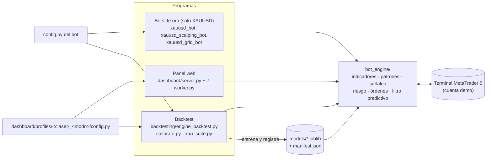
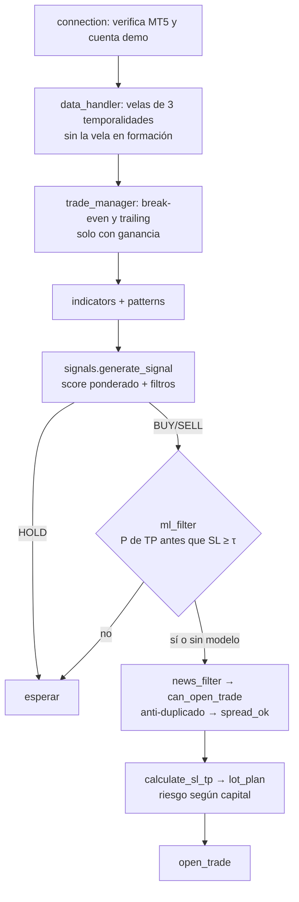
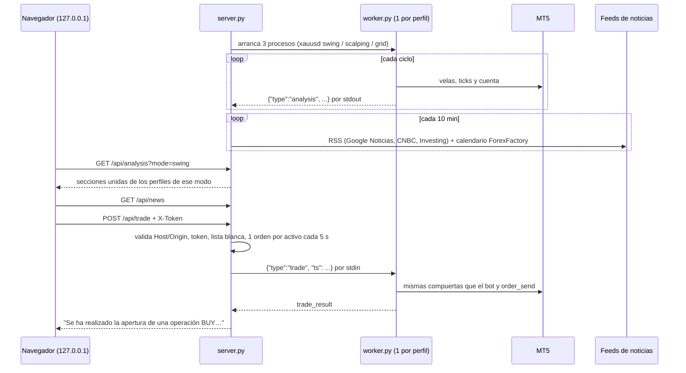
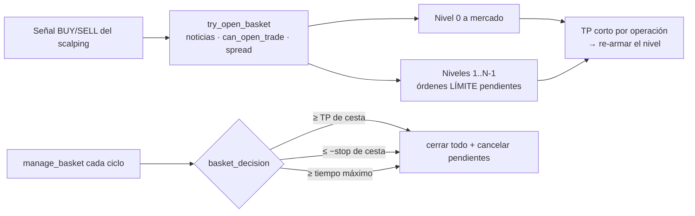
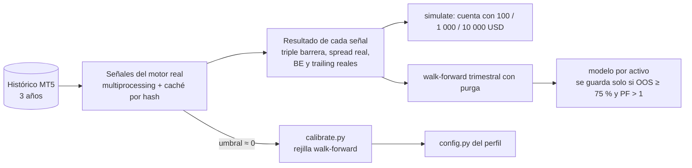

# Arquitectura

Cómo está armado el sistema y por qué. Las decisiones grandes tienen su ADR en [`adr/`](adr/).
Los valores numéricos exactos viven en cada `config.py`; aquí solo se citan para dar escala.

## Vista general

Tres programas usan **un solo motor** (`bot_engine/`):

- **Un proceso por config.** El motor importa `from config import …`. Cada proceso pone la carpeta
  de su config primero en `sys.path`, así que dos configs nunca chocan
  ([ADR 0001](adr/0001-motor-compartido.md)).
- **MT5 es la única fuente de datos y de órdenes.** El paquete `MetaTrader5` solo funciona en
  Windows, con el terminal abierto en el mismo usuario.

## El ciclo del bot

`bot_engine/core.py` → `run()` repite `_run_cycle()` cada `LOOP_INTERVAL` segundos:

| Etapa | Módulo | Nota |
|---|---|---|
| Datos | `data_handler.py` | Las horas son del **servidor** (`server_now()`), nunca la hora local. |
| Indicadores | `indicators.py` | EMA, RSI, MACD, ATR, ADX, Bollinger, VWAP, soportes y resistencias. |
| Patrones | `patterns.py` | 44 patrones de velas; su aporte al score se limita a ±4. |
| Señal | `signals.py` | Score ponderado (rango aprox. ±12) contra `MIN_SIGNAL_SCORE`; filtros de tendencia, RSI, ADX y macro. |
| Filtro predictivo | `ml_filter.py` | Meta-labeling con gradient boosting; solo carga modelos registrados en el manifiesto ([ADR 0002](adr/0002-filtro-predictivo-walk-forward.md)). |
| Riesgo | `risk_manager.py` | Nivel de capital, lote dinámico, riesgo elevado hasta 5 %, límite diario por bot y por cuenta ([ADR 0004](adr/0004-riesgo-cuentas-pequenas.md)). |
| Órdenes | `trade_manager.py` | Filling mode, `stops_level`, BE+, trailing progresivo; todo filtrado por `MAGIC_NUMBER`. |

## El panel web

- **Solo librería estándar** (`http.server`, `xml.etree`, `urllib`), sin CDN de scripts
  ([ADR 0005](adr/0005-panel-stdlib.md)). Las fuentes se cargan de Google Fonts y tienen respaldo del sistema.
- **Protocolo JSON por líneas.** El worker manda los logs del motor a stderr para no corromper stdout.
- **Gotcha de Windows.** El worker carga los modelos de scikit-learn **antes** de iniciar el hilo
  que lee stdin. Importar sklearn mientras un hilo bloquea `sys.stdin` deja el proceso colgado.
- **Órdenes viejas.** El worker descarta una orden con más de `TRADE_MAX_AGE` = 15 s; así nunca
  abre una orden que el servidor ya informó como vencida.
- **Horarios.** El servidor entrega epoch, y la página los convierte a la hora del sistema con `Intl`.
  Las sesiones de mercado se calculan con zonas IANA (Nueva York, Londres, Tokio, Sídney), así que
  el cambio de horario se maneja solo.
- **Ventaja de cada perfil.** El worker lee `backtesting/reports/calibration_<perfil>.json`. Si el PF
  fuera de muestra de la configuración vigente es ≤ 1, la página muestra "Sin ventaja probada".

## Perfiles del panel (solo XAUUSD)

`dashboard/profiles/_base.py` → `profile(name, base, tf, sections, **overrides)` carga el config del bot
tal cual (misma señal) y solo cambia la identidad del panel. Los perfiles por clase de
[ADR 0003](adr/0003-perfiles-por-clase.md) se retiraron el 2026-10-23.

| Perfil | Hereda de | TF |
|---|---|---|
| `xauusd_swing` | `xauusd_bot` | H1 |
| `xauusd_scalping` | `xauusd_scalping_bot` | M15 |
| `xauusd_grid` (modo **grid**) | `xauusd_grid_bot` (magic propio 20260631) | H1 |

Los parámetros que elige `backtesting/calibrate.py` se escriben debajo de la marca
`# ── Parámetros calibrados para esta clase …` de cada `config.py`, junto con un comentario que
registra la fecha y las métricas fuera de muestra.

## Grid + cesta (`bot_engine/grid.py`)

Solo se activa con `USE_GRID=True` (bot `xauusd_grid_bot` y perfil `xauusd_grid` del panel)
([ADR 0006](adr/0006-grid-cesta.md)).

- **Identidad de la cesta.** Cada orden lleva `G<id> L<nivel>` en el comentario (id = hora de apertura del
  servidor). Con eso se reconoce tras un reinicio. Lo que no sobrevive (los niveles para re-armar y el
  capital de apertura) se reemplaza por el balance actual.
- **P&L de cesta** = flotante (+swap) de las posiciones abiertas + cierres de este magic desde la apertura.
- **Tamaño por riesgo.** `build_basket` calcula el lote para que la cesta completa (todos los niveles
  llenos hasta el SL común) pierda ≤ `GRID_RISK_PCT`. Si el capital no alcanza, usa menos niveles; con un
  capital mayor, vuelven los niveles y sube el lote. En martingala, el riesgo total es el mismo.
- **Protecciones.** SL real en el bróker, cierre de viernes, horas bloqueadas y corte por drawdown
  (`dd_halt`).
- **Backtest.** `simulate_grid` recorre cada vela en orden conservador (hueco → extremo adverso →
  extremo favorable → cierre). Los límites y el SL se aplican en el orden en que el precio los cruza.
  Un límite llenado en el mínimo de una vela no puede salir en su máximo. Si la equity llega a 0, hace
  stop-out ("QUIEBRA").

## Backtest y calibración

- **Caché de señales.** La clave es `engine_hash`: el código de `bot_engine/`, el config del perfil,
  `_base.py`, los 4 configs de bots y los `--set`. Cambiar cualquiera de esos archivos invalida la caché.
- **Calibración con una sola pasada del motor.** Con umbral ≈ 0, la acción con umbral U es la misma
  acción si |score| ≥ U. Los filtros no dependen del umbral, y
  `test_threshold_applied_later_matches_engine` lo comprueba.

## Seguridad (resumen)

Más detalle en [`../SECURITY.md`](../SECURITY.md).

- **Cuenta.** Solo demo, salvo `ALLOW_LIVE_TRADING=1` en el `.env`.
- **Secretos.** Viven en el `.env`, que está en `.gitignore`.
- **Panel.** Escucha solo en `127.0.0.1`; pide token por sesión y revisa Host/Origin (anti
  DNS-rebinding y anti CSRF); tiene CSP y no se puede incrustar en otra página.
- **Modelos.** Un `.joblib` es un pickle, así que puede ejecutar código al cargarse. Por eso se verifica
  su SHA-256 contra `models/manifest.json` **antes** de `joblib.load`.
- **Noticias.** Son datos de terceros. Se rechazan las respuestas de más de 2 MB, los XML con
  DOCTYPE/ENTITY y los enlaces que no sean http(s), y la página escapa todo antes de mostrarlo.
